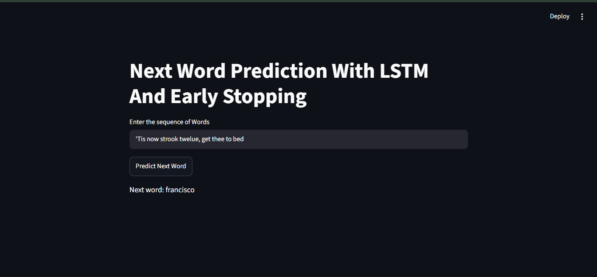

# LSTM Next Word Prediction 🧠

A next-word prediction web application built using Python, Streamlit, TensorFlow, and LSTM (Long Short-Term Memory) neural networks. The application predicts the next word based on the text entered by the user. The model is trained on Shakespeare's *Hamlet* text.

## 🚀 Live Demo

🔗 **Live Application:** [Try the App](YOUR_STREAMLIT_APP_LINK)


## 📸 Application Screenshot




## ✨ Features

- Predicts the next word from user-provided text.
- Uses an LSTM neural network for sequence learning.
- Built with Streamlit for an interactive web interface.
- Converts input text into token sequences using a trained tokenizer.
- Uses padding to prepare sequences for model input.
- Loads a pre-trained LSTM model for predictions.
- Provides a simple text input and prediction button.

## 🛠️ Technologies Used

- **Python** — Core programming language
- **TensorFlow / Keras** — LSTM model loading and prediction
- **Streamlit** — Web application interface
- **NumPy** — Selecting the predicted output
- **Pickle** — Loading the trained tokenizer
- **NLTK** — Text corpus used during data preparation
- **Jupyter Notebook** — Model development and experiments
- **Git and GitHub** — Version control

## 📂 Project Structure

```text
LSTM_Next_Word_Prediction/
│
├── screenshots/
├── app.png
├── venv/                  # Python virtual environment
├── .gitignore             # Files excluded from Git
├── app.py                 # Streamlit web application
├── experiments.ipynb      # Data preprocessing and model experiments
├── hamlet.txt             # Shakespeare's Hamlet text dataset
├── next_word_lstm.h5      # Trained LSTM model
├── tokenizer.pickle       # Saved tokenizer
├── requirements.txt       # Python dependencies
└── README.md              # Project documentation
```

**Note:** The `venv/` folder should not be uploaded to GitHub. The trained model and tokenizer must be available to the application at runtime.

## ⚙️ Installation and Setup

### 1. Clone the repository

```bash
git clone YOUR_GITHUB_REPOSITORY_URL
cd LSTM_Next_Word_Prediction
```

Replace `YOUR_GITHUB_REPOSITORY_URL` with your actual GitHub repository URL.

### 2. Create a virtual environment

```powershell
python -m venv venv
```

### 3. Activate the virtual environment

```powershell
.\venv\Scripts\Activate.ps1
```

If PowerShell blocks activation, run:

```powershell
Set-ExecutionPolicy -Scope Process -ExecutionPolicy RemoteSigned
.\venv\Scripts\Activate.ps1
```

### 4. Install dependencies

```bash
python -m pip install --upgrade pip
pip install -r requirements.txt
```

### 5. Run the Streamlit application

Make sure `app.py`, `next_word_lstm.h5`, and `tokenizer.pickle` are in the project root directory.

```bash
streamlit run app.py
```

Streamlit will provide a local URL, usually:

```text
http://localhost:8501
```

Open that URL in your browser to use the application.

## 🧠 How It Works

1. **User Input:** The user enters a sequence of words in the Streamlit interface.
2. **Tokenization:** The saved tokenizer converts the input text into numerical word IDs.
3. **Sequence Preparation:** The input sequence is truncated if necessary and padded to the required length.
4. **LSTM Prediction:** The pre-trained model calculates probabilities for possible next words.
5. **Word Selection:** The application selects a predicted word and displays it to the user.

## 💻 Example

Enter the following text in the application:

```text
To be or not to
```

Click the **Predict Next Word** button to display the model's predicted next word.

The prediction depends on the trained model and may not always be grammatically or contextually correct.

## 📊 Model Training and Evaluation

The model was developed and experimented with in `experiments.ipynb`.

The notebook includes text preprocessing, tokenization, input sequence generation, model training, and validation.

Training accuracy alone does not guarantee good predictions. Validation performance should also be monitored to identify possible overfitting.

## 🔮 Future Improvements

- Improve prediction accuracy and generalization.
- Display multiple possible next words with their probabilities.
- Improve the user interface and prediction results.
- Deploy the Streamlit application publicly.
- Experiment with different LSTM architectures and training settings.

## 👨‍💻 Author

**Vishal Kumar**

- GitHub: [Your GitHub Profile](YOUR_GITHUB_PROFILE_LINK)
